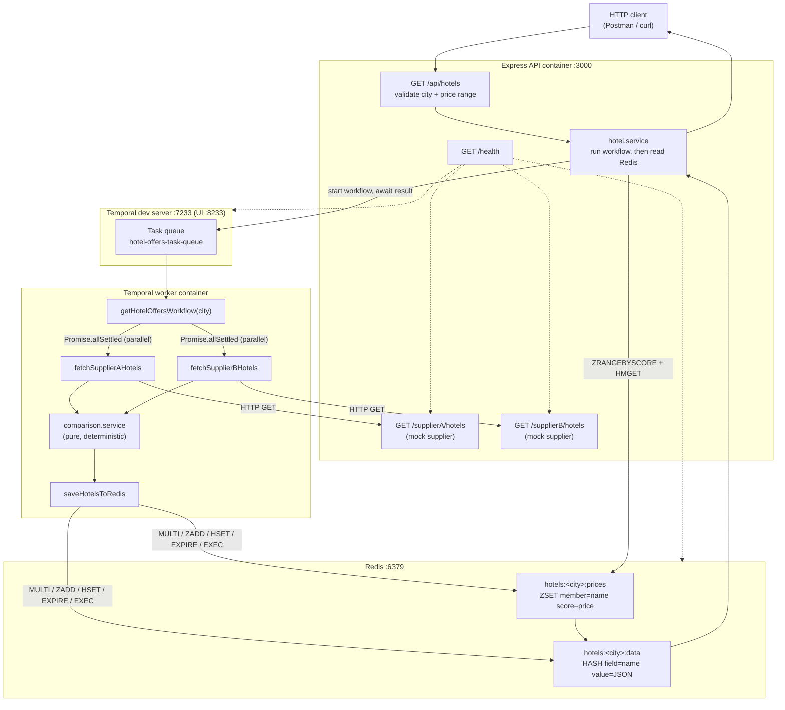

# Hotel Offer Orchestrator

A hotel offer aggregation service. It queries two mock hotel suppliers **concurrently through a real Temporal workflow**, deduplicates the combined catalogue by hotel name, keeps the cheapest offer per hotel, persists the result in **Redis** and serves it over an **Express** REST API with **price filtering executed by Redis itself** (`ZRANGEBYSCORE`).

---

## 1. Problem statement

A travel platform buys inventory from several suppliers. The same physical hotel appears in more than one supplier feed, under slightly different spellings, at different prices and with different commission percentages. The platform needs one clean, cheapest-wins list per city, fast price-range queries, and resilience when a supplier is down.

Concretely, the service must:

1. Call Supplier A and Supplier B for a requested city, in parallel.
2. Treat hotels with the same name (case- and whitespace-insensitive) as the same hotel.
3. Keep the cheaper of the two offers, preferring Supplier A on an exact tie.
4. Keep hotels that only one supplier sells.
5. Carry the commission percentage that belongs to the *winning* offer.
6. Survive one supplier being unavailable by returning partial results.
7. Answer price-range queries without loading the whole dataset into application memory.

---

## 2. Technology stack

| Concern | Choice |
| --- | --- |
| Runtime | Node.js 22 |
| Language | TypeScript 5 (`strict`) |
| HTTP API | Express 4 |
| Orchestration | Temporal.io TypeScript SDK 1.26 |
| Storage + filtering | Redis 7 (sorted set + hash) |
| Logging | pino (structured JSON) |
| Tests | Vitest, `ioredis-mock`, `@temporalio/testing`, supertest |
| Packaging | Docker, Docker Compose |
| API collection | Postman Collection v2.1 (runnable with newman) |

No relational database, no MongoDB, no in-process cache: Redis is the only datastore.

---

## 3. Architecture



Three runtime processes, four containers:

- **api** — Express: the public API *and* the two mock supplier endpoints. It starts workflows; it never calls suppliers itself.
- **worker** — the Temporal worker: hosts the workflow and all three activities. All HTTP and Redis I/O happens here, inside activities.
- **temporal** — the official Temporal CLI dev server (gRPC frontend + Web UI).
- **redis** — storage and the price-filtering engine.

### Separation of concerns

| Layer | Responsibility |
| --- | --- |
| `src/api` | HTTP: routing, validation, error envelopes, structured request logs |
| `src/services/comparison.service.ts` | Pure, deterministic dedupe/cheapest-offer logic (safe to run inside a workflow) |
| `src/services/hotel.service.ts` | Use case: run the workflow, then read the filtered snapshot |
| `src/temporal` | Workflow, activities, worker, client |
| `src/redis` | Key layout, MULTI snapshot replacement, `ZRANGEBYSCORE` queries |
| `src/suppliers` | Static mock catalogues served over HTTP |

---

## 4. Folder structure

```text
hotel-offer-orchestrator/
├── src/
│   ├── api/
│   │   ├── app.ts                            # Express app factory
│   │   ├── controllers/
│   │   │   ├── health.controller.ts           # dependency probes
│   │   │   ├── hotel.controller.ts            # GET /api/hotels
│   │   │   └── supplier.controller.ts         # mock supplier endpoints + outage switch
│   │   ├── middleware/
│   │   │   ├── error.middleware.ts            # error -> HTTP status + error envelope
│   │   │   └── request-logger.middleware.ts
│   │   ├── routes/
│   │   │   ├── health.routes.ts
│   │   │   ├── hotel.routes.ts
│   │   │   └── supplier.routes.ts
│   │   └── validators/
│   │       └── hotel.validator.ts             # city + price-range validation
│   ├── config/
│   │   └── env.ts                             # typed, validated environment configuration
│   ├── redis/
│   │   ├── client.ts                          # ioredis singleton + URL redaction
│   │   └── hotel.repository.ts                # ZSET/HASH model, MULTI writes, ZRANGEBYSCORE reads
│   ├── services/
│   │   ├── comparison.service.ts              # normalization, dedupe, cheapest-offer selection
│   │   └── hotel.service.ts                   # workflow + Redis read orchestration
│   ├── suppliers/
│   │   ├── supplierA.data.ts
│   │   └── supplierB.data.ts
│   ├── temporal/
│   │   ├── activities/hotel.activities.ts     # supplier HTTP calls + Redis persistence
│   │   ├── workflows/hotel.workflow.ts        # getHotelOffersWorkflow
│   │   ├── workflows/index.ts                 # workflow bundle entry point
│   │   ├── client.ts                          # connection, unique workflow IDs, health probe
│   │   └── worker.ts                          # worker process entry point
│   ├── types/hotel.types.ts
│   ├── utils/
│   │   ├── errors.ts                          # ApiError, RedisOperationError
│   │   └── logger.ts                          # pino
│   └── index.ts                               # API process entry point
├── tests/
│   ├── unit/
│   │   ├── comparison.service.test.ts
│   │   ├── hotel.activities.test.ts
│   │   └── hotel.validator.test.ts
│   └── integration/
│       ├── api.hotels.test.ts
│       ├── api.supplier-outage.test.ts
│       ├── hotel.repository.test.ts
│       └── hotel.workflow.test.ts             # runs on a real Temporal test server
├── postman/Hotel-Offer-Orchestrator.postman_collection.json
├── Dockerfile
├── docker-compose.yml
├── .dockerignore
├── .env.example
├── .gitignore
├── package.json
├── tsconfig.json
├── tsconfig.test.json
├── vitest.config.mts
└── README.md
```

---

## 5. How Temporal orchestrates the supplier calls

`getHotelOffersWorkflow(city)` ([src/temporal/workflows/hotel.workflow.ts](src/temporal/workflows/hotel.workflow.ts)):

1. Schedules `fetchSupplierAHotels(city)` and `fetchSupplierBHotels(city)` **concurrently** with `Promise.allSettled`, so both activity tasks are dispatched before either result is awaited.
2. Each activity performs a real HTTP `GET` against the mock supplier endpoint (`SUPPLIER_A_BASE_URL` / `SUPPLIER_B_BASE_URL`) with an abort timeout, and validates the payload shape.
3. Failures are classified per supplier:
   - one supplier failed → log a warning, continue with **partial results**;
   - both failed → throw a non-retryable `ApplicationFailure` of type `BothSuppliersFailed`, which the API maps to HTTP 502 `SUPPLIERS_UNAVAILABLE`.
4. The surviving records are merged by the **pure** `compareAndDeduplicate` function — no I/O, no clock, no randomness, so workflow replay stays deterministic.
5. `saveHotelsToRedis(city, hotels)` persists the snapshot (the only Redis write path).
6. The workflow returns the city, the per-supplier report, raw/deduplicated counts and the offer list.

Timeouts and retries:

| Activity | `startToClose` | `scheduleToClose` | Retries |
| --- | --- | --- | --- |
| `fetchSupplierAHotels` / `fetchSupplierBHotels` | 10 s | 30 s | 3 attempts, 200 ms initial interval, ×2 backoff, 2 s cap |
| `saveHotelsToRedis` | 10 s | 40 s | 5 attempts, same backoff |

Other Temporal details:

- Dedicated task queue: `hotel-offers-task-queue` (`TEMPORAL_TASK_QUEUE`).
- Workflow IDs are `hotel-offers-<city>-<uuid v4>`, so concurrent requests for the same city never collide.
- Workflow execution timeout: `WORKFLOW_EXECUTION_TIMEOUT_MS` (default 30 s).
- The workflow holds **no** HTTP or Redis code; the activity module is imported with `import type` only, so it is never bundled into the workflow sandbox.
- SDK and workflow logs are routed through the same pino logger as the rest of the service.

---

## 6. How Redis stores hotel data

Two keys per city, written together:

```text
hotels:<city>:prices   ZSET   member = normalized hotel name, score = price
hotels:<city>:data     HASH   field  = normalized hotel name, value = JSON offer
```

The normalized name (trimmed, internal whitespace collapsed, lowercased) is the identity used by both keys, so the index and the records can never drift apart.

Each hash value holds exactly the public offer shape:

```json
{ "name": "Holtin", "price": 5340, "supplier": "Supplier B", "commissionPct": 20 }
```

Writes replace the whole city snapshot inside a single transaction, so readers never observe a half-updated city:

```text
MULTI
  DEL    hotels:delhi:prices
  DEL    hotels:delhi:data
  ZADD   hotels:delhi:prices 4800 "the imperial" 5340 "holtin" ...
  HSET   hotels:delhi:data   "the imperial" {...} "holtin" {...} ...
  EXPIRE hotels:delhi:prices 300
  EXPIRE hotels:delhi:data   300
EXEC
```

An empty result set still runs the two `DEL`s, so a city that stops returning hotels leaves no stale data behind. The TTL comes from `HOTELS_TTL_SECONDS` (default 300 s).

---

## 6a. Deduplication rules, and the price tie-break

Applied by `compareAndDeduplicate` in [src/services/comparison.service.ts](src/services/comparison.service.ts), in this order:

| # | Rule | Example from the mock data |
| --- | --- | --- |
| 1 | Identity is the hotel name, trimmed, internal whitespace collapsed, lowercased | `"  The Leela  "` and `"The Leela"` are the same hotel |
| 2 | Across suppliers, the **cheaper gross price** wins | Holtin: A 6000 vs B 5340 → **B** |
| 3 | On an **exact price tie, Supplier A wins** | The Leela: A 7200 (11 %) vs B 7200 (17 %) → **A** |
| 4 | Duplicates *within* one supplier collapse the same way | A lists `Holtin` 6000 and `HOLTIN` 6450 → 6000 kept |
| 5 | A hotel only one supplier sells is kept as-is | Taj Palace (A only), Novotel (B only) |
| 6 | The winning offer's own `commissionPct` is carried | Holtin → B's 20 %, not A's 10 % |
| 7 | Output is sorted by price ascending, then by name | stable ordering for equal prices |

**On the tie-break specifically:** Supplier A is preferred deliberately and unconditionally — it is a fixed precedence rule, not a commission-based one. So The Leela resolves to Supplier A at 11 % even though Supplier B offers 17 % on the same 7200 price. Commission is *carried* with the winning offer but never *ranked* on, because the requirement is the cheapest offer for the customer and a tie must break deterministically (workflow replay must produce the same answer every time). Ranking by commission on a tie is a one-line change in `selectBetterOffer` if the business wants revenue to break ties instead — see rule 3 there.

---

## 6b. Why every request re-runs the workflow

`GET /api/hotels` always starts a Temporal workflow, refreshes the Redis snapshot, and only then reads the requested price window — including when `minPrice`/`maxPrice` are supplied. Filtered requests are not served from a previously saved snapshot.

This is deliberate:

- The brief describes the filtered endpoint as going through the same workflow, saving the deduplicated list to Redis and filtering by price inside Redis. Reading that as one pipeline, the workflow belongs on the request path and filtering is a property of the **read**, not of the workflow.
- It keeps results fresh: a request never returns prices from an earlier snapshot of unknown age.
- It keeps the two keys consistent with one code path — there is a single writer (the persistence activity) and a single reader (the repository).

The cost is that both suppliers are called on every request, and the TTL only bounds how long a snapshot survives after a city stops being requested. **If you would rather have filtered requests read the existing snapshot**, the change is small and localised to `lookupCityHotels` in [src/services/hotel.service.ts](src/services/hotel.service.ts): call `repository.countCityHotels(city)` first and skip `executeHotelOffersWorkflow` when a snapshot already exists (a read-through cache, with the TTL as the staleness bound). Nothing in the workflow, activities or repository would need to change.

---

## 7. How Redis performs the price filtering

Filtering happens **inside Redis**. The application never fetches the full dataset to filter it in JavaScript.

```text
ZRANGEBYSCORE hotels:delhi:prices 5000 7000     -> ["holtin", "radison"]
HMGET         hotels:delhi:data   holtin radison -> [ {...}, {...} ]
```

- `ZRANGEBYSCORE` returns only the members inside the window, already ordered by score, i.e. by price ascending — so the API response order needs no sorting pass.
- Omitted bounds become `-inf` / `+inf`, which covers all four cases (both bounds, min only, max only, neither).
- Redis score ranges are inclusive by default, which is exactly the required boundary behaviour.
- Only the matching hotels are then materialised, with one `HMGET` round trip.

See `HotelRepository.findCityHotels` in [src/redis/hotel.repository.ts](src/redis/hotel.repository.ts).

### Verifying it from outside the application

Because "Redis filters" and "the app filters after loading everything" look identical from the API response, here are three independent ways to check, without reading the source.

**1. Watch the commands Redis actually receives.** In one terminal:

```bash
docker compose exec redis redis-cli MONITOR
```

Then issue one filtered request:

```bash
curl "http://localhost:3000/api/hotels?city=delhi&minPrice=5000&maxPrice=7000"
```

`MONITOR` prints exactly this — the write transaction, then a **scored range query** followed by an `HMGET` of only the two matching members:

```text
"multi"
"del" "hotels:delhi:prices"
"del" "hotels:delhi:data"
"zadd" "hotels:delhi:prices" "4800" "the imperial" "5340" "holtin" ... "11000" "the oberoi"
"hset" "hotels:delhi:data" "the imperial" "{...}" "holtin" "{...}" ...
"expire" "hotels:delhi:prices" "300"
"expire" "hotels:delhi:data" "300"
"exec"
"zrangebyscore" "hotels:delhi:prices" "5000" "7000"
"hmget" "hotels:delhi:data" "holtin" "radison"
```

What matters is the absence of any whole-dataset read on the query path: there is no `HGETALL`, no `ZRANGE 0 -1`, no `KEYS`, and `HMGET` names only the members `ZRANGEBYSCORE` returned. With `minPrice` alone the bounds become `"7500" "+inf"`; with `maxPrice` alone, `"-inf" "5340"`.

**2. Compare the application log line.** Every query logs the exact bounds it handed to Redis and how many members came back:

```json
{"component":"hotel.repository","city":"delhi","min":"5000","max":"7000","matchedCount":2,"msg":"Queried Redis price index"}
```

**3. Reproduce the query by hand and compare.** The same two commands, run manually, return exactly what the API returned:

```bash
docker compose exec redis redis-cli ZRANGEBYSCORE hotels:delhi:prices 5000 7000
# 1) "holtin"   2) "radison"
```

A test also pins this behaviour: `tests/integration/hotel.repository.test.ts` spies on the Redis client and asserts the call was `zrangebyscore('hotels:delhi:prices', '5000', '7000')`, so a refactor that started filtering in JavaScript would fail the suite rather than pass silently.

Note that the index is the *only* thing consulted to decide which hotels match — the hash is addressed by the member names the index returned. A hotel present in the hash but absent from the sorted set can never appear in a filtered response (`findCityHotels` logs `Price index member missing from data hash` for the inverse case).

---

## 8. API documentation

Base URL: `http://localhost:3000`

### `GET /api/hotels`

| Query parameter | Required | Description |
| --- | --- | --- |
| `city` | yes | Letters, spaces, hyphens and apostrophes; case-insensitive. Known cities: `delhi`, `mumbai` |
| `minPrice` | no | Inclusive lower bound, ≥ 0 |
| `maxPrice` | no | Inclusive upper bound, ≥ 0, must be ≥ `minPrice` |

Each call runs the Temporal workflow (refreshing the Redis snapshot) and then returns the requested price window.

```bash
curl "http://localhost:3000/api/hotels?city=delhi"
```

```json
[
  { "name": "The Imperial", "price": 4800,  "supplier": "Supplier A", "commissionPct": 9 },
  { "name": "Holtin",       "price": 5340,  "supplier": "Supplier B", "commissionPct": 20 },
  { "name": "Radison",      "price": 5900,  "supplier": "Supplier A", "commissionPct": 13 },
  { "name": "The Leela",    "price": 7200,  "supplier": "Supplier A", "commissionPct": 11 },
  { "name": "Novotel",      "price": 7500,  "supplier": "Supplier B", "commissionPct": 12 },
  { "name": "Taj Palace",   "price": 9000,  "supplier": "Supplier A", "commissionPct": 15 },
  { "name": "The Oberoi",   "price": 11000, "supplier": "Supplier B", "commissionPct": 14 }
]
```

What that output demonstrates:

- `Holtin` exists in both feeds (A 6000 / B 5340) → the cheaper Supplier B offer wins, with Supplier B's 20 % commission.
- `Radison` exists in both (A 5900 / B 6200) → Supplier A wins.
- `The Leela` is 7200 in both → the tie goes to Supplier A.
- Supplier A also lists `HOLTIN` at 6450; that intra-supplier duplicate is collapsed too.
- `Taj Palace`, `The Imperial` (A only), `Novotel`, `The Oberoi` (B only) are retained.

```bash
curl "http://localhost:3000/api/hotels?city=delhi&minPrice=5000&maxPrice=7000"
```

```json
[
  { "name": "Holtin",  "price": 5340, "supplier": "Supplier B", "commissionPct": 20 },
  { "name": "Radison", "price": 5900, "supplier": "Supplier A", "commissionPct": 13 }
]
```

A city neither supplier covers returns `200` with `[]`.

#### `X-Partial-Results` response header

The success body is a bare array, so a partial result (one supplier down) is indistinguishable from a complete one by looking at the JSON. Every `200` therefore carries a header saying which it is, leaving the body format untouched:

```http
X-Partial-Results: false   # both suppliers answered
X-Partial-Results: true    # at least one supplier failed; these offers come from the rest
```

Nothing is required to read it, but a client that cares about completeness — a cache, or a UI wanting to show "prices may be incomplete" — can act on it without parsing the body.

### `GET /supplierA/hotels` and `GET /supplierB/hotels`

Mock supplier feeds (`?city=<city>`), returning the raw records including `hotelId`:

```json
[{ "hotelId": "a1", "name": "Holtin", "price": 6000, "city": "delhi", "commissionPct": 10 }]
```

Unsupported cities return `[]`. A disabled supplier returns HTTP 503.

### `GET /health`

```json
{
  "status": "ok",
  "checks": {
    "supplierA": { "status": "healthy" },
    "supplierB": { "status": "healthy" },
    "redis":     { "status": "healthy" },
    "temporal":  { "status": "healthy" }
  },
  "uptimeSeconds": 37
}
```

- `status` is `degraded` when any dependency is not `healthy`; each supplier is reported individually, with a `detail` string explaining why.
- The HTTP code is `503` only when Redis or Temporal is unreachable — a failed supplier alone still leaves the API usable (Temporal returns partial results), so it stays `200` with `status: "degraded"`.

### Error responses

Every error uses the same envelope:

```json
{ "error": { "code": "INVALID_PRICE_RANGE", "message": "minPrice cannot be greater than maxPrice" } }
```

| HTTP | Code | When |
| --- | --- | --- |
| 400 | `MISSING_CITY` | `city` not supplied |
| 400 | `INVALID_CITY` | empty, too long, or containing characters other than letters/spaces/hyphens/apostrophes |
| 400 | `INVALID_PRICE` | a price is not a finite number, or is negative |
| 400 | `INVALID_PRICE_RANGE` | `minPrice` > `maxPrice` |
| 404 | `NOT_FOUND` | unknown route |
| 502 | `SUPPLIERS_UNAVAILABLE` | the workflow failed because **both** suppliers failed |
| 502 | `WORKFLOW_FAILED` | any other workflow failure |
| 503 | `SUPPLIER_UNAVAILABLE` | a mock supplier endpoint is disabled by configuration |
| 503 | `REDIS_UNAVAILABLE` | a Redis operation failed |
| 503 | `WORKFLOW_FAILED` | the Temporal frontend is unreachable |
| 500 | `INTERNAL_ERROR` | unexpected server error |

---

## 9. Environment variables

Copy [.env.example](.env.example) to `.env` for local runs (both `npm start` and `npm run dev` load it automatically when present). Docker Compose supplies these values itself.

| Variable | Default | Purpose |
| --- | --- | --- |
| `NODE_ENV` | `development` | Runtime mode |
| `LOG_LEVEL` | `info` | pino level (`trace`…`error`) |
| `PORT` | `3000` | API port |
| `REDIS_URL` | `redis://localhost:6379` | Redis connection string (`redis://redis:6379` in Compose) |
| `HOTELS_TTL_SECONDS` | `300` | TTL for each city snapshot |
| `TEMPORAL_ADDRESS` | `localhost:7233` | Temporal frontend (`temporal:7233` in Compose) |
| `TEMPORAL_NAMESPACE` | `default` | Temporal namespace |
| `TEMPORAL_TASK_QUEUE` | `hotel-offers-task-queue` | Task queue shared by API and worker |
| `WORKFLOW_EXECUTION_TIMEOUT_MS` | `30000` | How long the API waits for a workflow |
| `SUPPLIER_A_BASE_URL` | `http://localhost:3000` | Base URL the activity uses for Supplier A (`http://api:3000` in Compose) |
| `SUPPLIER_B_BASE_URL` | `http://localhost:3000` | Base URL the activity uses for Supplier B |
| `SUPPLIER_TIMEOUT_MS` | `3000` | Per-request supplier HTTP timeout |
| `SUPPLIER_A_ENABLED` | `true` | `false` makes `/supplierA/hotels` return HTTP 503 |
| `SUPPLIER_B_ENABLED` | `true` | `false` makes `/supplierB/hotels` return HTTP 503 |

Invalid values (a non-numeric port, a non-boolean flag) fail at startup rather than silently falling back.

---

## 10. Running with Docker Compose (recommended)

```bash
docker compose up --build
```

> **Verification status: verified.** `docker compose up --build` was run cold on a clean machine (Docker Desktop 4.99.0, engine 29.9.3) with no host processes and all four ports free. All four containers come up healthy, the worker polls the task queue from inside its container, and the API, outage and Redis checks below were all re-run against the containerised stack. A quick way to confirm which mode you are looking at: `docker compose exec temporal temporal task-queue describe --task-queue hotel-offers-task-queue --address 127.0.0.1:7233` reports a worker identity like `1@aaeee3e97a8d` (the container's hostname); a host process would instead read `1234@YOUR-PC`.
>
> **Base image note.** The images are Debian-based (`node:22-bookworm-slim`), not Alpine, and that is deliberate — see the comment at the top of the [Dockerfile](Dockerfile). `@temporalio/core-bridge` ships a prebuilt `x86_64-unknown-linux-gnu` binary, so on a musl image the **worker** dies at startup with `ERR_DLOPEN_FAILED … ld-linux-x86-64.so.2`, while the API container keeps running happily on the pure-JS client — a failure mode that looks like a healthy stack until you check the worker.

That starts all four services with health checks and ordered startup (`redis` + `temporal` healthy → `api` healthy → `worker`):

| Service | Address | Notes |
| --- | --- | --- |
| API | http://localhost:3000 | Public API + mock suppliers |
| Temporal Web UI | http://localhost:8233 | Inspect workflow executions and their history |
| Temporal gRPC | `localhost:7233` | Used by the API and worker |
| Redis | `localhost:6379` | Persisted in the `redis-data` volume |

Smoke test:

```bash
curl "http://localhost:3000/health"
curl "http://localhost:3000/api/hotels?city=delhi"
curl "http://localhost:3000/api/hotels?city=delhi&minPrice=5000&maxPrice=7000"
```

Inspect what Redis actually holds:

```bash
docker compose exec redis redis-cli ZRANGE hotels:delhi:prices 0 -1 WITHSCORES
docker compose exec redis redis-cli ZRANGEBYSCORE hotels:delhi:prices 5000 7000
docker compose exec redis redis-cli HGET hotels:delhi:data holtin
docker compose exec redis redis-cli TTL hotels:delhi:prices
```

Tear down:

```bash
docker compose down -v
```

---

## 11. Running locally without Docker

Requires Node.js 22+, a reachable Redis and a reachable Temporal server.

```bash
npm install
cp .env.example .env

# Temporal dev server (Temporal CLI: https://docs.temporal.io/cli)
temporal server start-dev --ip 0.0.0.0        # gRPC :7233, Web UI :8233

# Redis
docker run --rm -p 6379:6379 redis:7-alpine   # or a local redis-server

# Terminal 1 - API (also hosts the mock supplier endpoints)
npm run dev

# Terminal 2 - Temporal worker
npm run dev:worker
```

Production-style build:

```bash
npm run build
npm start          # API
npm run start:worker   # worker (separate process)
```

Both processes must share `TEMPORAL_TASK_QUEUE`, and the worker must be able to reach the API's supplier endpoints via `SUPPLIER_A_BASE_URL` / `SUPPLIER_B_BASE_URL`.

---

## 12. Tests

```bash
npm test          # full suite
npm run typecheck # tsc --noEmit (strict)
```

| Suite | What it covers |
| --- | --- |
| `tests/unit/comparison.service.test.ts` | name normalization, cross- and intra-supplier dedupe, cheapest-offer selection, equal-price tie-break, single-supplier retention, commission carry-over, stable ordering |
| `tests/unit/hotel.validator.test.ts` | city validation, all four price-range combinations, negative/non-numeric/empty prices, `minPrice > maxPrice` |
| `tests/unit/hotel.activities.test.ts` | supplier activities against a mocked `fetch`: URL/query construction, 503 handling, unreachable endpoint, payload validation |
| `tests/integration/hotel.repository.test.ts` | Redis model on `ioredis-mock`: ZSET/HASH layout, TTL, MULTI snapshot replacement, `ZRANGEBYSCORE` bounds and inclusivity, empty snapshots, malformed records, failure wrapping |
| `tests/integration/api.hotels.test.ts` | API over HTTP (supertest): response shape, dedupe, all filter combinations, validation errors, workflow/Redis failure mapping, mock supplier endpoints, 404 |
| `tests/integration/hotel.workflow.test.ts` | **the real workflow on a real Temporal test server**: parallel activities, dedupe, persistence, single-supplier partial results, both-suppliers-failed `ApplicationFailure`, empty city |

The workflow suite downloads Temporal's ephemeral test server on first run, so the first `npm test` needs network access and takes longer.

Unit tests mock all external dependencies (`fetch`, Redis, the Temporal client); the workflow suite stubs only the activities, so the workflow itself genuinely executes.

---

## 13. Postman collection

[postman/Hotel-Offer-Orchestrator.postman_collection.json](postman/Hotel-Offer-Orchestrator.postman_collection.json) is a Collection v2.1 file with 14 requests: 12 that run against a healthy stack (37 assertions) plus a **"Supplier outage scenarios"** folder of 2 requests that assert the partial-results and total-outage contracts and skip themselves when the stack is healthy (see §14).

In Postman: **Import → File →** select the collection, then set the `baseUrl` collection variable (default `http://localhost:3000`) and use **Run collection**.

From the CLI:

```bash
npx newman run postman/Hotel-Offer-Orchestrator.postman_collection.json \
  --env-var baseUrl=http://localhost:3000
```

Covered requests: all Delhi hotels, min-only, max-only, min+max, a city with no results, invalid city, invalid price range, negative price, health, both supplier endpoints, a supplier endpoint for an unsupported city, and the two supplier-outage scenarios. The assertions check status codes, response structure, absence of duplicate hotel names, correct supplier/commission selection for overlapping hotels, price-range correctness and boundary inclusivity, price-ascending ordering, empty results for unknown cities, and the error envelope. The supplier and health requests assert both the healthy and the simulated-outage shapes, so the collection passes in either mode.

---

## 14. Simulating a supplier outage

Supplier availability is controlled only by environment variables — never by a request parameter.

```bash
# Supplier A down: the workflow returns Supplier B-only partial results
SUPPLIER_A_ENABLED=false docker compose up --build

# Both down: GET /api/hotels answers 502 SUPPLIERS_UNAVAILABLE
SUPPLIER_A_ENABLED=false SUPPLIER_B_ENABLED=false docker compose up --build
```

(`docker compose` reads these from your shell or from a `.env` file next to `docker-compose.yml`.)

With Supplier A disabled:

```bash
curl -i "http://localhost:3000/supplierA/hotels?city=delhi"
# HTTP/1.1 503  {"error":{"code":"SUPPLIER_UNAVAILABLE","message":"Supplier A is currently unavailable"}}

curl "http://localhost:3000/api/hotels?city=delhi"
# 200 - five hotels, all "supplier": "Supplier B"

curl "http://localhost:3000/health"
# 200 - {"status":"degraded","checks":{"supplierA":{"status":"disabled",...
```

The worker logs make the partial path explicit:

```text
Supplier responded with an error status            {"supplier":"Supplier A","status":503}
Continuing with partial supplier results          {"city":"delhi","failedSuppliers":["Supplier A"]}
Comparison and deduplication completed            {"rawOfferCount":6,"deduplicatedCount":5,"removedCount":1}
```

### What the client receives when both suppliers are down

The workflow fails with a non-retryable `ApplicationFailure` of type `BothSuppliersFailed`, and the API maps it to **502 Bad Gateway** with the standard JSON envelope — never a bare 500, and never an empty body. Captured verbatim from a running stack:

```http
$ curl -i "http://localhost:3000/api/hotels?city=delhi"

HTTP/1.1 502 Bad Gateway
Content-Type: application/json; charset=utf-8
Content-Length: 127
ETag: W/"7f-MABapIeOIEJ/CJBY81TalsNjFm8"
Date: Thu, 19 Nov 2026 22:52:44 GMT
Connection: keep-alive

{"error":{"code":"SUPPLIERS_UNAVAILABLE","message":"No supplier could be reached, so no hotel offers are available right now"}}
```

The other endpoints in that same state:

| Request | Status | Body |
| --- | --- | --- |
| `GET /api/hotels?city=delhi` | **502** | `{"error":{"code":"SUPPLIERS_UNAVAILABLE",…}}` |
| `GET /api/hotels?city=delhi&minPrice=5000&maxPrice=7000` | **502** | same — the filter is never reached |
| `GET /supplierA/hotels?city=delhi` | **503** | `{"error":{"code":"SUPPLIER_UNAVAILABLE",…}}` |
| `GET /supplierB/hotels?city=delhi` | **503** | `{"error":{"code":"SUPPLIER_UNAVAILABLE",…}}` |
| `GET /health` | **200** | `{"status":"degraded","checks":{"supplierA":{"status":"disabled",…},"supplierB":{"status":"disabled",…},"redis":{"status":"healthy"},"temporal":{"status":"healthy"}}}` |

Why 502 rather than 503: the orchestration layer reached its upstream dependencies and they refused, which is a bad-gateway condition. 503 is reserved for *this* service's own dependencies being unusable — `REDIS_UNAVAILABLE`, or the Temporal frontend being unreachable. `/health` deliberately stays 200 because the API process itself is fine; only its suppliers are gone. The full status/code mapping is in §8.

A 500 `INTERNAL_ERROR` is only ever returned for a genuinely unexpected exception; every anticipated failure has an explicit code.

### Why it is an environment variable and not a request flag

There is deliberately **no `?fail=true`, no `?simulateDown=true` and no admin route** — those query parameters are ignored and the endpoint responds normally. This is a design choice: an outage is a property of the supplier, not of an individual caller's request, so a public query flag would be the wrong mechanism. It would also let any caller change another caller's view of supplier health, and it would make the mock behave in a way no real supplier does.

The trade-off is that `SUPPLIER_A_ENABLED` / `SUPPLIER_B_ENABLED` are read **once at process startup**, so **changing them requires a restart**. The exact steps follow.

### Step-by-step: reproducing a supplier outage

**With Docker Compose**

```bash
# 1. Start normally and confirm the healthy baseline: 7 hotels
docker compose up --build -d
curl "http://localhost:3000/api/hotels?city=delhi"

# 2. Recreate the API and worker with Supplier A switched off
SUPPLIER_A_ENABLED=false docker compose up -d --force-recreate api worker

# 3. Confirm the supplier endpoint is now refusing
curl -i "http://localhost:3000/supplierA/hotels?city=delhi"
#    HTTP/1.1 503 Service Unavailable
#    {"error":{"code":"SUPPLIER_UNAVAILABLE","message":"Supplier A is currently unavailable"}}

# 4. The aggregate endpoint still answers, with partial results
curl "http://localhost:3000/api/hotels?city=delhi"
#    HTTP 200 - 5 hotels, every one "supplier":"Supplier B"

# 5. Health names the culprit
curl "http://localhost:3000/health"
#    {"status":"degraded","checks":{"supplierA":{"status":"disabled",...}}}

# 6. Now take both down
SUPPLIER_A_ENABLED=false SUPPLIER_B_ENABLED=false docker compose up -d --force-recreate api worker
curl -i "http://localhost:3000/api/hotels?city=delhi"
#    HTTP/1.1 502 Bad Gateway  (see the verbatim response below)

# 7. Restore
docker compose up -d --force-recreate api worker
```

On Windows PowerShell, set the variable before the command instead of inline:

```powershell
$env:SUPPLIER_A_ENABLED="false"; docker compose up -d --force-recreate api worker
Remove-Item Env:\SUPPLIER_A_ENABLED
```

**Running locally without Docker** — set the variable in `.env` (or in the shell) and restart the two processes:

```bash
# .env
SUPPLIER_A_ENABLED=false

npm start            # restart the API  (serves the mock supplier endpoints)
npm run start:worker # restart the worker (optional; only its logs change)
```

Only the **API** process needs restarting for the outage to take effect, because the supplier endpoints live there. The worker calls those endpoints over HTTP and picks up the 503 immediately.

### Verifying the outage path

Temporal's Web UI at http://localhost:8233 shows the retries and outcomes. In the workflow history the two shapes are clearly distinguishable:

```text
# one supplier down -> workflow still Completed, partial results
 5  ActivityTaskScheduled      (fetchSupplierAHotels)
 6  ActivityTaskScheduled      (fetchSupplierBHotels)   <- both scheduled before either completes
 8  ActivityTaskCompleted      (Supplier B)
13  ActivityTaskFailed         (Supplier A, after 3 attempts)
17  ActivityTaskScheduled      (saveHotelsToRedis)
19  ActivityTaskCompleted
23  WorkflowExecutionCompleted

# both down -> workflow Failed, no persistence activity at all
 8  ActivityTaskFailed
11  ActivityTaskFailed
14  WorkflowExecutionFailed
```

The Postman collection carries a **"Supplier outage scenarios"** folder for this: request 13 asserts the partial-results contract (HTTP 200, every offer from Supplier B, Radison falling back to B's 6200/18 %, Supplier A-only hotels absent, still deduplicated and price-ascending) and request 14 asserts HTTP 502 `SUPPLIERS_UNAVAILABLE`. Each one probes `/health` first and **skips itself with an explanatory message** when the stack is not in the matching state, so the folder is safe to run at any time:

```bash
# Supplier A down
SUPPLIER_A_ENABLED=false docker compose up -d --force-recreate api worker
npx newman run postman/Hotel-Offer-Orchestrator.postman_collection.json \
  --folder "Supplier outage scenarios (run with suppliers disabled)" \
  --env-var baseUrl=http://localhost:3000

# both down
SUPPLIER_A_ENABLED=false SUPPLIER_B_ENABLED=false docker compose up -d --force-recreate api worker
# ...same newman command
```

The automated suite covers the same ground without any manual setup: `tests/integration/hotel.workflow.test.ts` runs the real workflow against a real Temporal test server with each supplier activity failing in turn, and `tests/integration/api.supplier-outage.test.ts` covers the 503 endpoint and the `degraded` health report.

---

## 15. Logging

Structured JSON (pino) from both processes, with a `component` field per module. Logged events: incoming hotel requests with their filter parameters, workflow start/completion, each supplier call with its URL, response status, hotel count and duration, supplier failures, comparison/dedup counts (raw, deduplicated, removed), Redis persistence (saved count and TTL), Redis price-index queries (the exact `min`/`max` bounds and match count), request completion with status code and duration, and errors with their mapped HTTP status. Redis credentials are stripped before any URL is logged, and `authorization`/`cookie` headers are redacted.

---

## 16. Known limitations and assumptions

1. **Hotel name is the identity.** Two genuinely different hotels sharing a name in the same city would be merged; a real system would match on address/geo-coordinates or a supplier-independent property ID.
2. **Every API call runs a workflow**, filtered requests included — the rationale and the exact change needed to make it a read-through cache instead are in §6b.
3. **Supplier catalogues are static in-process data**, served over HTTP so the activities make genuine network calls. Only `delhi` and `mumbai` have inventory.
4. **Commission is carried, not applied.** The cheapest *gross* price wins; net-of-commission ranking was not requested.
5. **The Temporal dev server stores history in memory.** Restarting the `temporal` container clears workflow history. That is appropriate for a dev/demo stack, not for production, where a persistent Temporal cluster (and `temporalio/auto-setup` with a real database) is required.
6. **Prices are assumed to be in one currency**; no currency field or FX conversion exists.
7. **No authentication, rate limiting or pagination** on the API, and Redis runs without a password on the Compose network — all out of scope for this assignment.
8. **The workflow stores its result in the workflow output as well as in Redis.** For very large cities this would approach Temporal's payload limits; a production version would return counts only and let the API read Redis exclusively.
